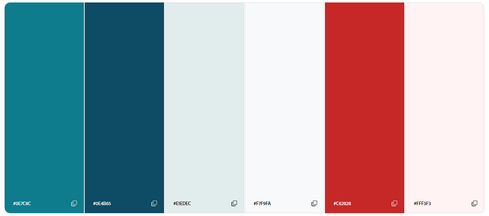
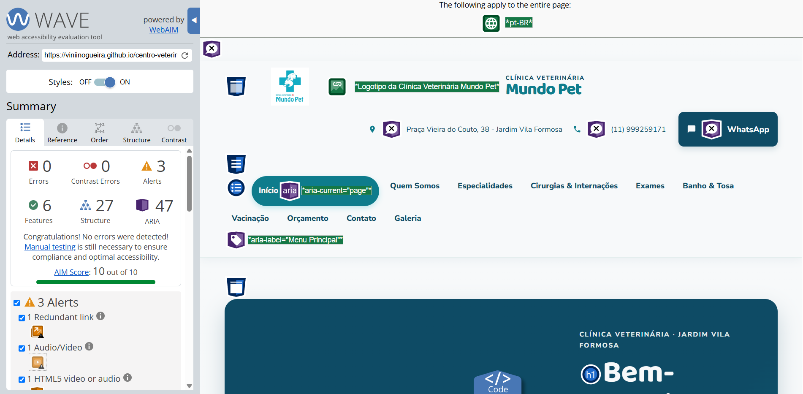

# Centro Veterinário Mundo Pet

## Integrantes do grupo

- Bruna - RGM: 48293237 brunasantosdias10112006-bit

- Eduardo - RGM: 47478497 - edudeabreu008
- Nicole - RGM: 47259701 - alejandra-apaza-tech
- Vinicius - RGM: 47697318 - ViniiNogueira 

## Introdução

A organização escolhida pelo grupo foi o **Centro Veterinário Mundo Pet**, uma clínica voltada ao cuidado, à saúde e ao bem-estar de animais de estimação. O projeto tem como objetivo promover a clínica por meio de um site informativo, apresentando seus serviços, especialidades e canais de atendimento de maneira clara e organizada.

A proposta é facilitar o acesso dos tutores a informações sobre consultas, vacinação, exames, cirurgias, internação, banho e tosa, além de oferecer caminhos para contato e solicitação de orçamento.

## Desenvolvimento

Até o momento, foi desenvolvido o HTML do site e a estrutura inicial do projeto. As páginas foram organizadas para representar as principais áreas de atendimento da clínica:

- Página inicial;
- Quem Somos;
- Especialidades;
- Cirurgias e Internações;
- Exames;
- Banho e Tosa;
- Vacinação;
- Orçamento;
- Contato;
- Galeria.

O desenvolvimento foi realizado de forma colaborativa. Todos os integrantes participaram da construção do projeto e contribuíram para que a estrutura do site representasse a organização escolhida. Durante a implementação, tivemos um pouco de dificuldade para integrar o JavaScript ao site, mas, fora isso, não enfrentamos grandes dificuldades. O trabalho envolveu a criação das páginas, a organização da navegação e a inclusão de informações relevantes sobre a clínica.

### Design System

Antes de iniciar o desenvolvimento da estilização, foi realizada uma pesquisa de design com base em referências do segmento, e a partir dela foi definida uma paleta de cores e um conjunto de diretrizes visuais. Todo o material está documentado em [docs/Design_System](docs/Design_System.md).

Durante a validação com a proprietária da marca, ela optou por manter a paleta de cores atual. A decisão foi tomada porque a marca já é reconhecida pelo público com essas cores, e alterá-las poderia causar estranhamento ou prejudicar o reconhecimento da identidade visual.

Por isso, o site utiliza a paleta original da marca, e os demais elementos do Design System (como tipografia, espaçamentos e componentes) foram mantidos como referência

#### Paleta de cores

A paleta final utilizada no site, baseada nas cores originais da marca, é a seguinte:

Para garantir a acessibilidade sem alterar a identidade da marca, os pares de cor usados em texto foram validados quanto ao contraste (veja a seção de validação com o WAVE).

### Validação com o W3C validator

Após o desenvolvimento todas as paginas foram testadas no W3C validator e todos os erros foram corrigidos 

para a validaação usamos o site: [W3C Validator](https://validator.w3.org/)

### Acessibilidade validada com WAVE

A acessibilidade do site foi validada com o [WAVE (Web Accessibility Evaluation Tool)](https://wave.webaim.org/), ferramenta da WebAIM que analisa a página renderizada e sinaliza, direto sobre ela, problemas que podem dificultar o uso por pessoas com deficiência.

O WAVE verifica, entre outros pontos:

- **Contraste de cores:** se a relação entre texto e fundo atende aos mínimos da WCAG 2.1 nível AA (4.5:1 para texto normal e 3:1 para texto grande e componentes de interface)
- **Texto alternativo:** se as imagens possuem o atributo `alt`
- **Formulários:** se os campos estão associados a `label`
- **Links e botões:** se não estão vazios e se possuem texto compreensível
- **Estrutura da página:** hierarquia de títulos (`h1` a `h6`), landmarks (`header`, `nav`, `main`, `footer`) e idioma declarado no `<html>`
- **Uso de ARIA:** se os atributos de acessibilidade foram aplicados corretamente

Após os ajustes de cores e tamanhos de fonte, a análise não apontou nenhum erro, como mostra a imagem abaixo.

## Deploy

Após a finalização da estrutura HTML das páginas, o projeto foi publicado utilizando o **GitHub Pages**, ferramenta gratuita de hospedagem estática integrada ao GitHub. Essa etapa permitiu que o site ficasse disponível on-line, possibilitando que o professor e demais avaliadores acessassem o resultado do trabalho diretamente pelo navegador, sem necessidade de baixar ou configurar o projeto localmente.

O site pode ser acessado através do link: [Centro Veterinário Mundo Pet](https://viniinogueira.github.io/centro-veterinario-mundo-pet/)

Ou pelo endereço completo:
https://viniinogueira.github.io/centro-veterinario-mundo-pet/

### Uso de inteligência artificial

Durante o desenvolvimento, utilizamos ferramentas de inteligência artificial como apoio para realizar verificações no projeto e esclarecer dúvidas relacionadas à estrutura do HTML, à organização das páginas e à documentação. A IA foi utilizada como recurso de consulta e revisão, enquanto a pesquisa, as decisões sobre o conteúdo e a participação na construção do site foram realizadas pelos integrantes do grupo.

### Comprovação do contato com a organização

Como parte da pesquisa e do desenvolvimento do projeto, o grupo realizou contato por reunião on-line para conhecer melhor a organização escolhida e alinhar as informações utilizadas no site. A imagem abaixo registra esse momento com a Danielle que é a dona da clínica:

**Contato da responsável:** Danielle (médica veterinária responsável pela clínica) — (11) 99925-9171, disponível caso o professor deseje entrar em contato com a Responsável.

## Conclusão

O desenvolvimento do site permitiu ao grupo aplicar conhecimentos de estruturação de páginas HTML, organização de conteúdo e criação de uma navegação coerente entre diferentes seções. Mesmo estando em uma etapa inicial, o projeto já apresenta uma base funcional para promover o Centro Veterinário Mundo Pet e facilitar o acesso dos tutores às informações sobre seus serviços.

Além do aprendizado técnico, a atividade reforçou a importância do trabalho em equipe, da divisão de tarefas e do contato com a organização escolhida. Cada integrante teve uma contribuição importante para a construção do resultado. Como continuidade, o grupo pretende aperfeiçoar o design e ampliar os recursos do site, tornando a experiência mais completa, acessível e atrativa para os usuários.

## Tecnologias utilizadas

- HTML5
- CSS3
- javaScript
